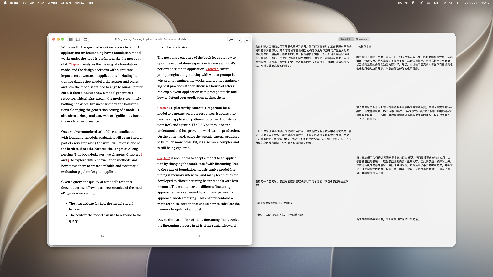

# BooksHelper

[简体中文](README.zh-CN.md)

BooksHelper is a menu bar app for macOS that adds a sidebar to Apple Books. It follows the page you are reading and shows a translation or a short summary in your chosen language.



## Requirements

- macOS 27.2 or later for the current build.
- Accessibility permission so BooksHelper can read the text and layout of the current page in Apple Books.
- A running Ollama server and an installed text model for summaries and Ollama translations. BooksHelper connects to Ollama at `127.0.0.1:11434`.

The source also builds with macOS 26.0 as the deployment target. Building for macOS 15 requires version checks for two System Translation error codes added in macOS 26. Apple Books integration has yet to be tested on either older version.

## Install

Signed and notarized builds are planned for GitHub Releases. In the meantime, you can open `BooksHelper.xcodeproj` in Xcode, select the `BooksHelper` scheme, and run it on your Mac.

## Use BooksHelper

1. Open BooksHelper and choose **Enable Books Text Access…** from its menu bar icon. Enable BooksHelper under **Privacy & Security → Accessibility** in System Settings.
2. Open a book in Apple Books. The sidebar appears next to the reading window and follows you as you turn pages.
3. Choose **Translation → Translate To** in the menu bar to set the output language. Use **Translate** or **Summary** at the top of the sidebar to switch views.

BooksHelper uses macOS System Translation by default. To use a local model for translation, choose **Translation → Engine → Ollama**, then select a model in **Translation → Model**. Summaries use local Ollama and follow the same output language setting.

With Ollama, translations and summaries appear as the model generates them. During translation, the original text stays in place until the translated text covers it. Completed results are kept in memory for quick access when you return to a page.

## Project structure

- `BooksHelper/Reading` reads the current page and finds the position of each paragraph.
- `BooksHelper/Sidebar` manages the sidebar, text layout, and animations.
- `BooksHelper/Translation` handles System Translation, Ollama requests, and cached results.
- `BooksHelperTests` and `BooksHelperUITests` contain unit and UI tests.
- `Scripts/test-system-menu-bar.swift` checks language switching from the macOS menu bar.

## Run the tests

Use the `BooksHelper` scheme in Xcode, or run this command from the repository root.

```sh
xcodebuild -project BooksHelper.xcodeproj -scheme BooksHelper \
  -configuration Debug -destination 'platform=macOS' \
  -derivedDataPath /tmp/books-helper-validation CODE_SIGN_IDENTITY=- \
  -parallel-testing-enabled NO test
```

The UI tests use a sample reading page and sample translations. To test the real macOS menu bar, quit any running copy of BooksHelper, then run this command from a terminal with Accessibility permission.

```sh
swift Scripts/test-system-menu-bar.swift \
  /tmp/books-helper-validation/Build/Products/Debug/BooksHelper.app
```
